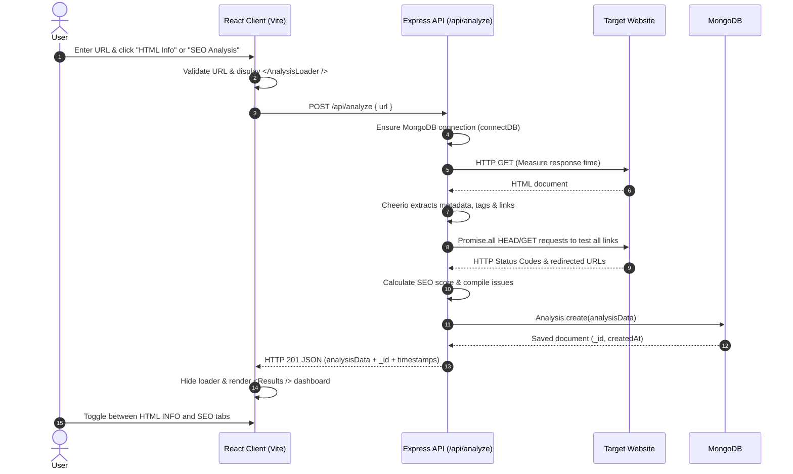

# LinkLens

> Inspect what's behind the link — page structure, asset footprints, broken links, and SEO health in real time.


---

## Overview

When building or auditing web pages, getting a rapid snapshot of what search engines and scrapers actually see often requires clunky browser extensions or multi-step manual audits.

**LinkLens** is a full-stack web inspection tool that takes any submitted URL, parses its rendered markup on the server, tests discovered hyperlinks, evaluates essential on-page SEO signals, and persists the audit record in MongoDB. The frontend delivers a responsive dashboard with interactive visual effects and an animated inspection state.

---

## Features

- **Document Structure Extraction**: Parses the target page DOM using Cheerio to extract `<title>`, `<meta name="description">`, `<link rel="canonical">`, and counts of `<h1>`, `<h2>`, and `<h3>` tags.
- **Asset Breakdown**: Counts total images, flags images missing `alt` attributes, and tallies external scripts and stylesheets.
- **Link Discovery & Validation**:
  - Differentiates internal vs. external links against the root hostname.
  - Sends asynchronous `HEAD` requests (with `GET` fallback on HTTP `405`) to test each link's health.
  - Detects broken links (`404` / `410`) and identifies redirected URLs.
- **Automated Rule-Based SEO Scoring**:
  - Calculates an SEO score (0–100) based on title presence/length, meta description completeness, single `<h1>` enforcement, image `alt` coverage, canonical tags, and HTTPS enforcement.
  - Assigns categorical ratings: *Excellent*, *Good*, *Needs Improvement*, or *Poor*.
  - Compiles an actionable list of warnings and errors with specific guidance.
- **Server Performance Measurement**: Captures upstream HTTP request roundtrip time (`responseTime` in milliseconds).
- **Persistent Audit Records**: Saves every full analysis payload into MongoDB via Mongoose timestamps.
- **Interactive UI**:
  - Step-by-step animated loading sequence during inspection (`AnalysisLoader`).
  - View switcher between **HTML INFO** (page structure, tags, assets) and **SEO ANALYSIS** (score, response time, categorized issues).
  - Custom UI touches: cursor glow trail, magnetic buttons, and animated background grid.

---

## UI Preview

<!-- Placeholders for application screenshots -->
| Landing & URL Input | Inspection Results |
|:---:|:---:|
|  |  |

---

## Tech Stack

### Frontend
- **Framework**: [React 19](https://react.dev/)
- **Bundler / Tooling**: [Vite 8](https://vitejs.dev/)
- **Linter**: [oxlint](https://oxc-project.github.io/)
- **Styling & UI**: Vanilla CSS with custom animations, canvas-based `BackgroundGrid`, `CursorGlow`, and `Magnetic` interaction components.

### Backend
- **Runtime**: [Node.js](https://nodejs.org/) (CommonJS)
- **Web Framework**: [Express 5](https://expressjs.com/)
- **HTML Scraping & DOM Traversal**: [Cheerio](https://cheerio.js.org/)
- **Database / ODM**: [MongoDB](https://www.mongodb.com/) via [Mongoose 9](https://mongoosejs.com/)
- **Networking & Utilities**: Native `fetch` (with `undici` in Node runtime), `cors`, `dotenv`

---

## How It Works



---

## Project Structure

```text
LINKLENS/
├── package.json              # Backend dependencies and root start script
├── package-lock.json
├── .gitignore
├── src/
│   ├── server.js             # Express app, scraping engine, SEO scoring & DB logic
│   └── models/
│       └── Analysis.js       # Mongoose schema and model definition
│
└── frontend/
    ├── package.json          # Frontend dependencies (React 19, Vite, oxlint)
    ├── package-lock.json
    ├── vite.config.js        # Vite config with @vitejs/plugin-react
    ├── index.html            # Single page app entry HTML
    ├── public/
    │   ├── favicon.svg
    │   └── icons.svg
    └── src/
        ├── main.jsx          # React DOM root entry point
        ├── App.jsx           # Main UI container, form handling, Results, SEO & HTML views
        ├── App.css           # Layout and theme styling
        ├── index.css         # Global resets and CSS variables
        ├── assets/
        │   ├── beagle-sprite.svg
        │   ├── hero.png
        │   ├── react.svg
        │   └── vite.svg
        └── components/
            ├── AnalysisLoader.jsx # Multi-step visual progress state
            ├── BackgroundGrid.jsx # Interactive canvas background grid
            ├── CursorGlow.jsx     # Mouse-follower glow trail
            └── Magnetic.jsx       # Physics-inspired magnetic button wrapper
```

---

## API Documentation

### Base URL
By default, the backend runs on `http://localhost:3000` (or the port specified by `PORT`).

---

### 1. Health Check
Checks if the server is up.

- **Method**: `GET`
- **Path**: `/`
- **Response**: `200 OK`
```json
{
  "message": "la la linkLens "
}
```

---

### 2. Analyze Website
Scrapes, audits, and persists an SEO/structure snapshot of the given website.

- **Method**: `POST`
- **Path**: `/api/analyze`
- **Headers**: `Content-Type: application/json`
- **Request Body**:
```json
{
  "url": "https://example.com"
}
```

- **Success Response**: `201 Created`
```json
{
  "_id": "6724a8e2f891b0c0e1234567",
  "url": "https://example.com",
  "htmlInfo": {
    "title": "Example Domain",
    "description": "Example website description...",
    "canonical": "https://example.com/",
    "links": {
      "total": 1,
      "internal": 0,
      "external": 1,
      "broken": 0,
      "redirected": 0
    },
    "images": {
      "total": 0,
      "missingAlt": 0
    },
    "scripts": 0,
    "stylesheets": 0,
    "headings": {
      "h1": 1,
      "h2": 0,
      "h3": 0
    }
  },
  "seo": {
    "performance": {
      "responseTime": "142 ms"
    },
    "score": 90,
    "rating": "Excellent",
    "issues": [
      {
        "severity": "warning",
        "type": "title-length",
        "message": "Title length could be improved",
        "details": "Your title is 14 characters. Aim for roughly 30–60 characters."
      }
    ]
  },
  "linkChecks": [
    {
      "url": "https://www.iana.org/domains/example",
      "statusCode": 200,
      "finalUrl": "https://www.iana.org/domains/example"
    }
  ],
  "createdAt": "2026-10-31T22:15:30.123Z"
}
```

- **Error Responses**:
  - `500 Internal Server Error`: Target site could not be fetched, parsed, or reached.
    ```json
    {
      "error": "Failed to analyze website",
      "message": "fetch failed"
    }
    ```
  - `503 Service Unavailable`: MongoDB connection unavailable.
    ```json
    {
      "error": "Database temporarily unavailable"
    }
    ```

---

## Database Design

LinkLens uses **MongoDB** via **Mongoose**. All audits are stored in the `analyses` collection.

### Schema Definition (`src/models/Analysis.js`)

```javascript
const analysisSchema = new mongoose.Schema(
  {
    url: {
      type: String,
      required: true,
      index: true
    },
    htmlInfo: {
      type: mongoose.Schema.Types.Mixed,
      required: true
    },
    seo: {
      type: mongoose.Schema.Types.Mixed,
      required: true
    },
    linkChecks: {
      type: [mongoose.Schema.Types.Mixed],
      default: []
    }
  },
  {
    timestamps: true // Automatically manages createdAt and updatedAt
  }
);
```

---

## Installation & Setup

### Prerequisites
- **Node.js**: v18.0.0 or higher
- **npm**: v9.0.0 or higher
- **MongoDB**: A running local MongoDB instance or a [MongoDB Atlas](https://www.mongodb.com/atlas) connection URI.

---

### 1. Clone the Repository
```bash
git clone https://github.com/your-username/linklens.git
cd linklens
```

### 2. Install Backend Dependencies
From the repository root:
```bash
npm install
```

### 3. Install Frontend Dependencies
```bash
cd frontend
npm install
cd ..
```

---

## Environment Variables

### Backend Configuration (`.env` in root)
Create a `.env` file in the root directory:

```env
# Port for the Express backend server (default: 3000)
PORT=3000

# MongoDB connection string (local or Atlas)
MONGODB_URL=mongodb://localhost:27017/linklens
```

### Frontend Configuration (`frontend/.env` or `frontend/.env.local`)
Create a `.env` file inside the `frontend/` directory:

```env
# Base URL for the backend API
VITE_API_URL=http://localhost:3000
```

> **Security Note**: Never commit `.env` files with actual database credentials to version control. Keep `.env` and `.env.local` in `.gitignore`.

---

## Running Locally

Because LinkLens is divided into a backend service and a Vite client, you run both in separate terminal windows:

### Terminal 1: Backend Server
From the project root:
```bash
npm start
```
*Runs `node src/server.js` on `http://localhost:3000`.*

> **Note on Server Execution**: `src/server.js` exports the `app` instance. When starting with `npm start`, ensure your entry script or environment initializes `app.listen(PORT)` if running outside a serverless wrapper.

### Terminal 2: Frontend Client
From the `frontend/` directory:
```bash
cd frontend
npm run dev
```
*Starts the Vite dev server (typically on `http://localhost:5173`).*

Open your browser at `http://localhost:5173`, enter any website URL, and test the analysis.

---

## Current Limitations

- **Client-Side Rendering (SPA) Crawling**: Cheerio parses static HTML retrieved via `fetch()`. Websites requiring client-side JavaScript execution (e.g., heavy CSR Single Page Applications) will only return initial shell markup without dynamically hydrated tags.
- **Unbounded Link Verification**: The server performs concurrent `HEAD`/`GET` requests on all discovered links using `Promise.all()`. For pages with hundreds of outbound links, this can cause rate limiting or long request times.
- **Single Page Scope**: LinkLens inspects the specific URL submitted rather than running a full multi-page crawl or sitemap audit.
- **History Retrieval Endpoint**: Past analyses are saved to MongoDB, but there is currently no backend query endpoint (`GET /api/history`) or UI screen to view historical runs.
- **Direct Server-Side Fetching**: Requests are made directly from the host IP without proxy rotation or custom user-agent spoofing; sites with strict bot defenses (Cloudflare, Akamai) may block requests.

---

## Future Improvements

- [ ] **History & Search Dashboard**: Add `GET /api/analyses` to display past audits with search and filtering by domain.
- [ ] **Batch & Concurrency Limiting**: Wrap link validation in a pooled worker queue (e.g., `p-limit`) to prevent network flooding.
- [ ] **Headless Browser Fallback**: Integrate Playwright or Puppeteer as an optional fallback for SPA / JavaScript-rendered applications.
- [ ] **Core Web Vitals & Lighthouse**: Integrate Google PageSpeed Insights API for real-world user metrics and mobile responsiveness.
- [ ] **Export Reports**: Allow users to download audit results as PDF or JSON summaries.

---

## Behind the Build

LinkLens came out of needing a straightforward way to inspect what an HTTP scraper sees before diving into full-blown browser developer tools. 

Building it involved solving a few interesting edge cases:
- Handling arbitrary links on the web means dealing with relative paths, non-standard protocols (`javascript:`, `mailto:`), and servers that reject `HEAD` requests with `405 Method Not Allowed` (requiring graceful fallbacks to standard `GET`).
- Balancing database connectivity so serverless environments or local Express instances connect cleanly without holding dangling connection promises.
- Creating an interface with visual feedback—adding the step loader, smooth cursor tracking, and modular result views so inspecting a page feels snappy and intuitive.

---

## Contributing

Contributions and issue reports are welcome!

1. Fork the repository.
2. Create your feature branch (`git checkout -b feature/improvement`).
3. Commit your changes (`git commit -m "Add feature description"`).
4. Push to the branch (`git push origin feature/improvement`).
5. Open a Pull Request.

---

## License

This project is licensed under the **ISC License** as specified in `package.json`.

